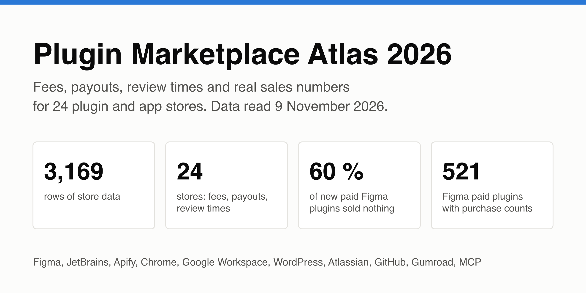
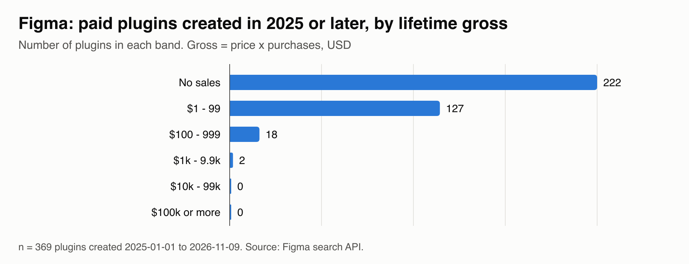

# Plugin Marketplace Atlas 2026

Fees, payouts, review times and real sales numbers for 24 plugin and app stores: Figma, JetBrains, Apify, Chrome, Google Workspace, WordPress, Atlassian, GitHub Marketplace, Shopify, Gumroad, MCP directories and more. Data read from each store's own API on 9 November 2026.

This repo is the free sample. The full Atlas has 3,169 rows and a 24-page report; it costs USD 24 once on GitHub Sponsors and includes the December 2026 refresh.

[Get the full Atlas (USD 24)](https://github.com/sponsors/theluckystrike) 

## What you learn from it

- Most new paid plugins sell nothing: 60 % of the 369 paid Figma plugins created since 2025 show zero purchases.
- The winners are large: the top Figma plugin by gross shows 6,725 purchases at USD 39.
- JetBrains paid plugins: median 33,506 downloads, median USD 19 a year personal.
- Which stores pay sellers in countries without Stripe, checked store by store.

## What is in the sample and what is in the full Atlas

| File | Sample (this repo) | Full Atlas |
|---|---|---|
| `figma-paid-plugins.csv` | first 15 rows | 521 rows |
| `jetbrains-paid.csv` | first 15 rows | 200 rows |
| `apify-actors.csv` | first 15 rows | 1,030 rows |
| `wordpress-doc-viewers.csv` | first 15 rows | 136 rows |
| `gumroad-digital-products.csv` | first 15 rows | 85 rows |
| `chrome-scan.csv` | first 15 rows | 89 rows |
| `workspace-scan.csv` | first 15 rows | 23 rows |
| `atlassian-paid-apps.csv` | first 15 rows | 500 rows |
| `github-marketplace-apps.csv` | first 15 rows | 300 rows |
| `mcp-servers-smithery.csv` | first 15 rows | 261 rows |
| `stores.csv` / `stores.md` | fee and review time | all 15 columns: payouts, minimums, timing, merchant of record, sign-up steps, listing rules, non-Stripe payout |
| `ATLAS-2026-11.pdf` | - | the full report with charts |
| December 2026 refresh | - | included |

Every row in both versions has `source_url`, `fetched` and `value_status` (F = the store's own API or page, reported = a third-party page, E = estimate).

## How it was made

See [METHOD.md](METHOD.md). In short: public store APIs and pages, read once on 9 November 2026; numbers, prices, dates and URLs only; no copied descriptions; no personal data.

## How buying works

1. Open [GitHub Sponsors](https://github.com/sponsors/theluckystrike) and pick the one-time "Plugin Marketplace Atlas 2026" tier (USD 24).
2. GitHub gives your account read access to the private repo `theluckystrike/plugin-marketplace-atlas-full` right away.
3. Clone it or download the ZIP. The December refresh appears in the same repo.

## Licence

The sample is CC BY 4.0: use it with credit to "Plugin Marketplace Atlas (Zovo)". The full Atlas may be used in your own work but not resold or republished as data.

## Support Zovo

Zovo builds and maintains this Atlas and a set of free developer tools. If the sample helps you, you can support the work on [GitHub Sponsors](https://github.com/sponsors/theluckystrike) or [PayPal](https://www.paypal.com/paypalme/najzzz).

Zovo is made by [theluckystrike](https://github.com/theluckystrike) on GitHub.

## More by Zovo

- [App Store and Google Play Reviews](https://apify.com/zovo-one/app-store-google-play-reviews). Gets App Store and Google Play reviews in one run, with one schema.
- [XLSX Viewer & CSV Preview for Excel, XLS & Parquet](https://marketplace.visualstudio.com/items?itemName=zovo.table-viewer-vscode). Opens CSV, TSV, Excel and Parquet files as a sortable, filterable table.
- [Large JSON Viewer, JSON Browser & JSON Tree](https://marketplace.visualstudio.com/items?itemName=zovo.zovo-json-tree-viewer). Shows large JSON files as a searchable tree, copies JSONPath and turns arrays of objects into a table.
- [Hex Viewer & Binary Viewer, Hex Editor (Large Files)](https://marketplace.visualstudio.com/items?itemName=zovo.zovo-hex-viewer). Hex viewer, binary viewer and hex editor for VS Code that opens files of any size (4 GB and more) in under a second. Insert and delete bytes, compare two files byte by byte, go to offset, find hex or text, a data inspector, copy as C array or base64. Free, works offline.
- [Claude Code Usage, Codex Usage & Gemini CLI Usage Meter](https://marketplace.visualstudio.com/items?itemName=zovo.ai-usage-meter). Shows Claude Code and Codex tokens and estimated cost from your local session files.
